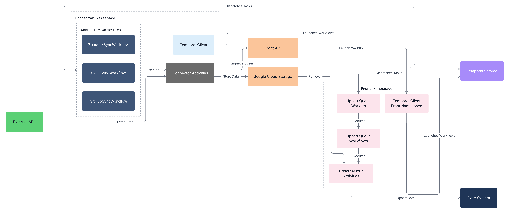
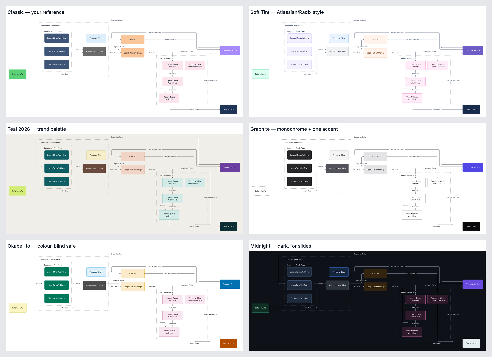

# flow-diagram-style

A Claude skill for drawing system, architecture and pipeline diagrams in one
consistent house style: left-to-right flow, flat boxes coloured by role, dashed
groups with monospace titles, and thin orthogonal edges with inline verb labels.

You (or Claude) describe **what** is in the diagram in a short YAML spec. The
renderer decides **how** it looks and **where** everything goes, then exports
SVG, PNG, or an editable draw.io diagram (works in draw.io, LeanIX and
Confluence).



## Why

- **Consistent:** every diagram uses the same roles, colours, fonts and spacing,
  no matter who (or which model) wrote it.
- **No hand layout:** the engine (built on [ELK](https://eclipse.dev/elk/))
  tries many layouts and keeps the one with the fewest crossings, the fewest
  lines through boxes and labels, and the largest readable text.
- **Editable output:** the draw.io export contains real shapes and connectors,
  so you can tweak the result instead of redrawing it.
- **Works offline:** `flow-diagram.html` is a single file with everything
  embedded. Nothing is uploaded, and it runs fine where code execution is
  blocked.

## Example

This spec produced the diagram above:

```yaml
title: Temporal Connector Sync
direction: right

groups:
  connector: {label: Connector Namespace}
  workflows: {label: Connector Workflows, parent: connector}
  front:     {label: Front Namespace}

nodes:
  tclient:    {label: Temporal Client, role: client, group: connector}
  slack:      {label: SlackSyncWorkflow, role: workflow, group: workflows}
  activities: {label: Connector Activities, role: activity, group: connector}
  temporal:   {label: Temporal Service, role: service}
  external:   {label: External APIs, role: external}
  gcs:        {label: Google Cloud Storage, role: storage}
  core:       {label: Core System, role: core}
  # ...

edges:
  - [tclient, temporal, Launches Workflows]   # [from, to, label]
  - [temporal, workflows, Dispatches Tasks]   # an edge may point at a group
  - [external, activities, Fetch Data]
  - [activities, gcs, Store Data]
  # ...
```

The full file is [`example.yaml`](example.yaml).

### Themes

Roles decide what a box means; the theme only decides the paint. Six themes are
built in: `classic`, `tint`, `teal`, `mono`, `okabe` (safe for colour-blind
readers) and `midnight` (dark).



## Installation

### Claude Code

Clone the repo into your skills folder:

```bash
# for you, in every project
git clone https://github.com/kiranm516/flow-diagram-style.git ~/.claude/skills/flow-diagram-style

# or for one project (shared with the team through the repo)
git clone https://github.com/kiranm516/flow-diagram-style.git .claude/skills/flow-diagram-style
```

To let Claude render diagrams itself (rather than handing you a spec), install
the renderer's dependencies once. This needs Node 18 or newer:

```bash
npm install --prefix ~/.claude/skills/flow-diagram-style/src
```

### Claude apps (claude.ai, desktop)

Zip the repo folder (without `src/node_modules`) and upload it under
**Settings → Capabilities → Skills**.

### Without Claude

Open [`flow-diagram.html`](flow-diagram.html) in any browser. No install needed.

## Usage

### Ask Claude

Once the skill is installed, ask for a diagram in plain words:

> Draw an architecture diagram of our checkout flow: the web app calls the Order
> API, which publishes to Kafka; the fulfilment workers consume it and write to
> Postgres. I need it in Confluence.

Claude writes the YAML spec. With code execution it also renders `.svg` and
`.drawio` files. Without it, Claude gives you the spec to paste into the HTML
tool.

### The HTML tool

1. Open `flow-diagram.html` and paste a spec into the left pane. The diagram
   re-renders as you type (or press Ctrl/Cmd + Enter).
2. Pick a theme from the toolbar if you want one.
3. Export:

   | Button           | Use it for                                                       |
   |------------------|------------------------------------------------------------------|
   | Copy for draw.io | Click a draw.io, LeanIX or Confluence draw.io canvas and Ctrl+V   |
   | Copy image       | Paste into Teams, PowerPoint or a Confluence page                 |
   | PNG / SVG        | Download an image (PNG is 2× for sharp slides)                    |
   | .drawio          | Download a file for File → Import in draw.io                      |

Your last spec and theme are remembered in the browser.

### Command line

```bash
node src/flowdiag.mjs my-diagram.yaml out/my-diagram
# -> out/my-diagram.svg, out/my-diagram.drawio
```

Add `--report` to print the scores of the runner-up layouts.

## Spec reference

| Key         | Values                                                      | Default |
|-------------|-------------------------------------------------------------|---------|
| `title`     | Diagram name, used for file names                           |         |
| `direction` | `right`, `down`, `auto` (tries both)                         | `right` |
| `frame`     | `[width, height]` to fit, e.g. a slide                      | `[1600, 900]` |
| `sizing`    | `role` (same role, same width), `group`, `all`, `fit`        | `role`  |
| `theme`     | `classic`, `tint`, `teal`, `mono`, `okabe`, `midnight`       | `classic` |
| `groups`    | `id: {label, parent?, direction?}`; nesting up to 2 levels  |         |
| `nodes`     | `id: {label, role, group?, col?}`; `\n` in a label wraps it  |         |
| `edges`     | `[from, to, Label]`; `from` and `to` may be groups           |         |

Every node needs a `role` and every edge needs a label:

| Role       | Use for                                          |
|------------|--------------------------------------------------|
| `client`   | SDK, client or UI that starts the work           |
| `service`  | Central orchestrator, hub or bus                 |
| `member`   | Components inside a highlighted subsystem        |
| `workflow` | Definitions, jobs or handlers in a family        |
| `activity` | Units that do the actual work                    |
| `external` | Third-party systems outside your control         |
| `storage`  | Data stores, queues, APIs that hold data         |
| `core`     | System of record or final destination            |

[`SKILL.md`](SKILL.md) has the writing rules and tips for steering the layout
(for example, what to change when a diagram is too wide or its lines cross).

## Development

```text
SKILL.md              instructions Claude reads
example.yaml          example spec (also the HTML tool's starting content)
flow-diagram.html     built offline tool (generated, but committed)
src/engine.mjs        layout search, scoring, SVG and draw.io output
src/flowdiag.mjs      command-line renderer
src/tool.template.html  HTML tool source
src/build.mjs         bundles the template, engine, libraries and fonts
src/test.mjs          layout regression test; fixtures in src/test/
```

```bash
cd src
npm install
npm test              # compare layout scores with src/test/scores.json
npm run build         # rebuild ../flow-diagram.html
```

The HTML tool's "Spec reference" panel is copied from the YAML block in
`SKILL.md` at build time, so edit it there and rebuild.

If you change layout or scoring on purpose, render the test specs and look at
them, then accept the new scores with `node test.mjs --update`. To try other
score weights without editing code, set `FLOWDIAG_WEIGHTS`, for example
`FLOWDIAG_WEIGHTS='{"detour":0.05}' node flowdiag.mjs spec.yaml out`.
